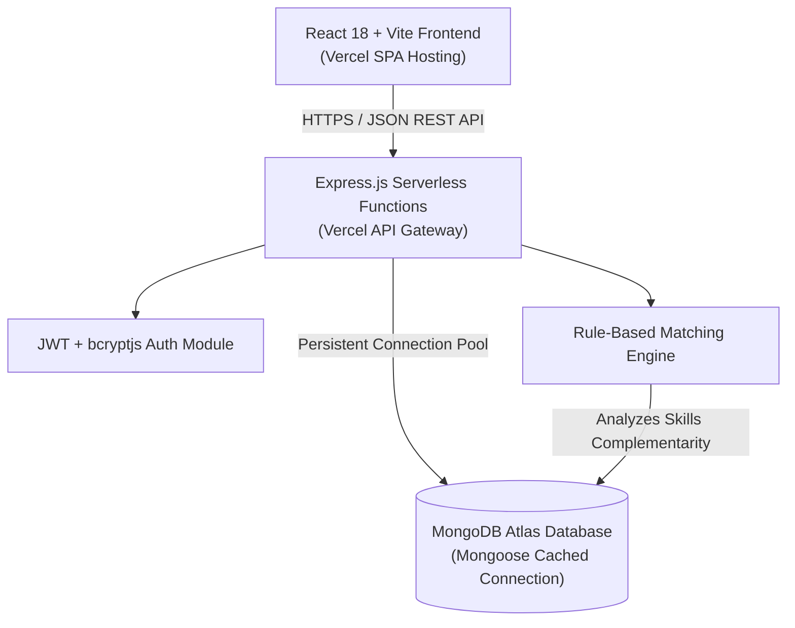
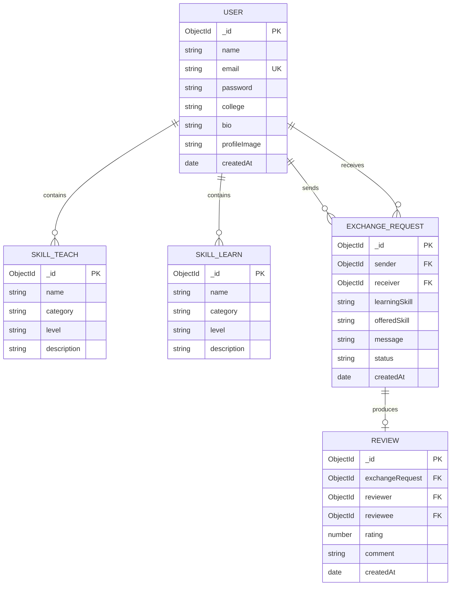

# SkillSwap – Peer-to-Peer Skill Exchange Platform

> **Learn Something New. Teach What You Know.**
> A modern, full-stack collaborative platform enabling students to exchange skills and knowledge with zero monetary cost.

---

## 📌 1. Project Overview

**SkillSwap** is a full-stack peer-to-peer (P2P) web application engineered to solve knowledge-sharing barriers among university and college students. While many students possess valuable technical and creative skills (e.g., Java, React, Figma, Video Editing), others seek to learn those skills but face financial constraints or lack personalized peer mentorship.

SkillSwap allows students to:
- Discover complementary skill matches automatically via an intelligent rule-based matching engine.
- Send, negotiate, accept, and track direct skill exchange proposals.
- Build verified on-chain style community reputations through mutual peer reviews and 5-star ratings.

### Practical Example:
- **Rahul** (IIT Bombay) knows **Java** and wants to learn **Photoshop**.
- **Priya** (NID Ahmedabad) knows **Photoshop** and wants to learn **Java**.
- **SkillSwap** pairs Rahul and Priya with a **Perfect Match** recommendation badge, enabling seamless barter-based education.

---

## 🚀 2. Live Links & Repository

| Resource | Target Link |
| :--- | :--- |
| **GitHub Repository** | [https://github.com/ShuvayuShown/SkillSwap](https://github.com/ShuvayuShown/SkillSwap) |
| **Live Frontend App (Vercel)** | [https://skillswap-student.vercel.app](https://skillswap-student.vercel.app) *(or your deployed Vercel URL)* |
| **Backend REST API (Vercel)** | [https://skillswap-api.vercel.app](https://skillswap-api.vercel.app) *(or your deployed Vercel API URL)* |

---

## 🛠️ 3. Technology Stack

### Frontend
- **Framework:** React 18 with Vite
- **Routing:** React Router DOM (v6)
- **HTTP Client:** Axios with request/response interceptors & credentials
- **State Management:** React Context API (`AuthContext`, `ToastContext`)
- **Icons:** Lucide React
- **Design System:** Custom CSS design system inspired by Linear & Notion with violet/indigo palette (`#4f46e5`), soft elevations, and fully responsive grid & drawer architecture.

### Backend
- **Runtime:** Node.js (ES Modules)
- **Web Framework:** Express.js
- **Database Engine:** MongoDB Atlas / Local MongoDB Server 9.0
- **ODM:** Mongoose (v8) with connection caching across serverless invocations
- **Authentication:** JSON Web Tokens (JWT) & bcryptjs password hashing
- **Security:** HTTP-only cookies, CORS with origin whitelist, Express rate-limiting, centralized error handling

### Deployment & CI/CD
- **Version Control:** Git & GitHub
- **Platform:** Vercel (Frontend SPA + Serverless Backend Functions)

---

## 🏛️ 4. System Architecture



---

## 🗄️ 5. Database Schema & Collections



---

## ⚡ 6. Core Features

1. **Intelligent Skill Matching Engine:**
   - Detects complementary matches where Student A teaches what Student B wants, and vice versa.
   - Generates transparent, human-readable explanations (e.g. *Perfect Match: Can teach you "Photoshop" and wants to learn "Java" from you!*).
2. **Dynamic Skill Management:**
   - Add, edit, and delete skills in 14 distinct categories across 4 proficiency levels (*Beginner*, *Intermediate*, *Advanced*, *Expert*).
   - Duplicate prevention stops redundant entries.
3. **Three-Way Exchange Lifecycle:**
   - **Received Requests:** Accept or decline with live updates.
   - **Sent Requests:** Monitor pending status or cancel before acceptance.
   - **Completed Exchanges:** Track history and unlock 5-star peer evaluations.
4. **Verified Reviews & Ratings:**
   - Submitting reviews is strictly restricted to participants of *completed* exchanges.
   - Compound database indexes prevent duplicate reviews for the same exchange.
5. **Modern SaaS UI/UX:**
   - Clean, high-contrast, distraction-free typography.
   - Instant toast alerts, loading spinners, and empty states.
   - Fully responsive sidebar converting to a mobile drawer navigation.

---

## 📡 7. RESTful API Documentation

| Method | Endpoint | Access | Description |
| :--- | :--- | :--- | :--- |
| **POST** | `/api/auth/register` | Public | Register new student account |
| **POST** | `/api/auth/login` | Public | Authenticate user & return JWT token |
| **POST** | `/api/auth/logout` | Public | Clear session cookie |
| **GET** | `/api/auth/me` | Private | Fetch current authenticated student profile |
| **GET** | `/api/users` | Public | Search and filter students by skill, category, & level |
| **GET** | `/api/users/:id` | Public | Get single student profile with verified reviews |
| **PUT** | `/api/users/profile` | Private | Update student bio, college, and profile avatar |
| **GET** | `/api/skills` | Public | Get metadata list of categories and proficiency levels |
| **POST** | `/api/skills/teach` | Private | Add skill user can teach |
| **PUT** | `/api/skills/teach/:id`| Private | Update existing teaching skill |
| **DELETE**| `/api/skills/teach/:id`| Private | Remove teaching skill |
| **POST** | `/api/skills/learn` | Private | Add skill user wants to learn |
| **PUT** | `/api/skills/learn/:id`| Private | Update existing learning interest |
| **DELETE**| `/api/skills/learn/:id`| Private | Remove learning interest |
| **POST** | `/api/requests` | Private | Send a skill exchange proposal |
| **GET** | `/api/requests/received` | Private | List all incoming exchange proposals |
| **GET** | `/api/requests/sent` | Private | List all outgoing exchange proposals |
| **GET** | `/api/requests/completed`| Private| List completed exchanges eligible for review |
| **PATCH**| `/api/requests/:id/accept` | Private | Accept received exchange proposal |
| **PATCH**| `/api/requests/:id/reject` | Private | Decline received exchange proposal |
| **PATCH**| `/api/requests/:id/cancel` | Private | Cancel sent pending exchange proposal |
| **PATCH**| `/api/requests/:id/complete`| Private| Mark accepted exchange as completed |
| **POST** | `/api/reviews` | Private | Submit 5-star review for completed exchange |
| **GET** | `/api/reviews/:userId` | Public | Get all reviews received by student |
| **GET** | `/api/dashboard/stats` | Private | Get dashboard metrics and recent activity |
| **GET** | `/api/dashboard/recommendations` | Private | Get rule-based complementary student matches |
| **GET** | `/api/health` | Public | Service health & database connectivity check |

---

## 📂 8. Project Structure

```
SkillSwap/
│
├── client/                     # Frontend (React 18 + Vite)
│   ├── public/
│   │   └── favicon.svg         # Platform branding icon
│   ├── src/
│   │   ├── components/         # Reusable UI components
│   │   │   ├── AddSkillModal.jsx
│   │   │   ├── ExchangeModal.jsx
│   │   │   ├── Footer.jsx
│   │   │   ├── Navbar.jsx
│   │   │   ├── ProfileEditModal.jsx
│   │   │   ├── ProtectedRoute.jsx
│   │   │   ├── ReviewModal.jsx
│   │   │   ├── Sidebar.jsx
│   │   │   ├── SkillBadge.jsx
│   │   │   ├── StarRating.jsx
│   │   │   └── StudentCard.jsx
│   │   ├── context/            # React Context providers
│   │   │   ├── AuthContext.jsx
│   │   │   └── ToastContext.jsx
│   │   ├── pages/              # View pages
│   │   │   ├── DashboardPage.jsx
│   │   │   ├── ExplorePage.jsx
│   │   │   ├── LandingPage.jsx
│   │   │   ├── LoginPage.jsx
│   │   │   ├── ManageSkillsPage.jsx
│   │   │   ├── ProfilePage.jsx
│   │   │   ├── RegisterPage.jsx
│   │   │   └── RequestsPage.jsx
│   │   ├── services/
│   │   │   └── api.js          # Axios API client
│   │   ├── App.jsx             # React Router configuration
│   │   ├── index.css           # Modern SaaS Design System
│   │   └── main.jsx            # React root mount
│   ├── index.html
│   ├── package.json
│   ├── vercel.json             # Vercel SPA rewrites
│   ├── vite.config.js
│   └── .env.example
│
├── server/                     # Backend (Node.js + Express + Mongoose)
│   ├── api/
│   │   └── index.js            # Vercel Serverless Function entry point
│   ├── config/
│   │   └── db.js               # MongoDB connection with serverless pooling
│   ├── controllers/            # Route handlers & business logic
│   │   ├── authController.js
│   │   ├── dashboardController.js
│   │   ├── requestController.js
│   │   ├── reviewController.js
│   │   ├── skillController.js
│   │   └── userController.js
│   ├── middleware/             # Auth & Error handling middleware
│   │   ├── authMiddleware.js
│   │   └── errorMiddleware.js
│   ├── models/                 # Mongoose schemas
│   │   ├── ExchangeRequest.js
│   │   ├── Review.js
│   │   └── User.js
│   ├── routes/                 # Express router declarations
│   │   ├── authRoutes.js
│   │   ├── dashboardRoutes.js
│   │   ├── requestRoutes.js
│   │   ├── reviewRoutes.js
│   │   ├── skillRoutes.js
│   │   └── userRoutes.js
│   ├── utils/
│   │   ├── matchingEngine.js   # Rule-based matching engine
│   │   └── seedData.js         # Realistic student demo seeder
│   ├── index.js                # Express app setup & CORS
│   ├── server.js               # Local runner
│   ├── test_api.js             # 14-step integration test runner
│   ├── package.json
│   ├── vercel.json             # Vercel serverless configuration
│   └── .env.example
│
├── .gitignore
├── package.json                # Monorepo scripts
└── README.md
```

---

## 💻 9. Local Installation & Setup

### Prerequisites
- **Node.js:** v18.0.0 or higher
- **MongoDB:** MongoDB Atlas connection string OR local MongoDB Server 9.0 running on `127.0.0.1:27017`
- **Git**

### Step-by-Step Setup

1. **Clone the repository:**
   ```bash
   git clone https://github.com/ShuvayuShown/SkillSwap.git
   cd SkillSwap
   ```

2. **Configure Backend Environment Variables:**
   ```bash
   cd server
   cp .env.example .env
   ```
   Edit `server/.env`:
   ```env
   PORT=5000
   MONGODB_URI=mongodb://127.0.0.1:27017/skillswap
   JWT_SECRET=skillswap_super_secret_jwt_key_2026_dev_prod
   NODE_ENV=development
   CLIENT_URL=http://localhost:5173
   ```

3. **Install Dependencies & Seed Initial Data:**
   ```bash
   npm install
   npm run seed
   ```
   *(Optional)* Run the automated 14-step backend test suite:
   ```bash
   npm test
   ```

4. **Start Backend Server:**
   ```bash
   npm start
   # Server runs at http://localhost:5000
   ```

5. **Configure & Start Frontend:**
   Open a separate terminal window:
   ```bash
   cd ../client
   cp .env.example .env
   npm install
   npm run dev
   # Vite dev server runs at http://localhost:5173
   ```

6. Open your browser and navigate to `http://localhost:5173`.

---

## 👥 10. Demo Credentials (For Testing)

If you ran `npm run seed`, you can use the pre-configured complementary accounts:

| Name | Role / Expertise | Email | Password |
| :--- | :--- | :--- | :--- |
| **Rahul Sharma** | Teaches Java, wants Photoshop | `rahul.sharma@example.com` | `Password@123` |
| **Priya Patel** | Teaches Photoshop, wants Java | `priya.patel@example.com` | `Password@123` |
| **Aarav Mehta** | Teaches ReactJS, wants ML | `aarav.mehta@example.com` | `Password@123` |
| **Ananya Iyer** | Teaches Python & ML, wants React | `ananya.iyer@example.com` | `Password@123` |

---

## 🚀 11. Deployment to Vercel

### Deploying the Backend API
1. Install Vercel CLI: `npm i -g vercel`
2. Navigate to `server/`:
   ```bash
   cd server
   vercel --prod
   ```
3. Set the following Environment Variables in the Vercel Project Dashboard:
   - `MONGODB_URI`: Your MongoDB Atlas URI
   - `JWT_SECRET`: Secure random secret key
   - `NODE_ENV`: `production`
   - `CLIENT_URL`: Your deployed frontend URL

### Deploying the Frontend Client
1. Navigate to `client/`:
   ```bash
   cd client
   vercel --prod
   ```
2. Set Environment Variable in Vercel:
   - `VITE_API_URL`: The deployed Backend URL (e.g. `https://your-backend.vercel.app/api`)

---

## 🔮 12. Future Enhancements
- [ ] Real-time peer-to-peer WebSocket messaging for session scheduling.
- [ ] In-app video/voice room integration using WebRTC.
- [ ] Integrated certificate generation for student LinkedIn portfolios after 5 completed swaps.
- [ ] Campus-specific filters and student identity verification with university email domains (.edu, .ac.in).

---

## 📜 13. License & Author
- Developed by **Shuvayu Shown**
- Course: Full-Stack Web Application Frameworks
- License: MIT License
